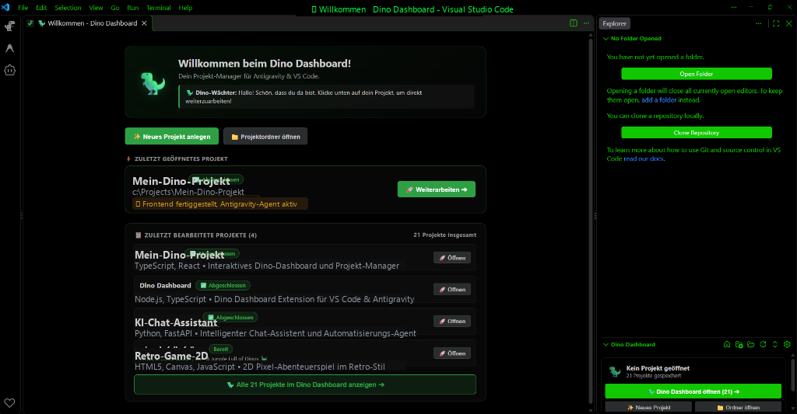

# Dino Dashboard (Deutsch) - Projekt-Manager fuer Antigravity & VS Code



> **Das Dino Dashboard** ist deine zentrale Projektverwaltung auf Deutsch fuer Antigravity & VS Code. Du kannst neue Projekte im Handumdrehen anlegen, bestehende Ordner hinzufuegen, eigene Projektnamen vergeben, Status-Hinweise setzen, Notizen in einem eigenen Fenster verwalten und jedes Projekt mit **einem einzigen Klick direkt in Antigravity laden**, um sofort weiterzuarbeiten.

---

## Hauptfunktionen

### 1. Neues Projekt anlegen (mit automatischem Wechsel)
- Klicke oben auf **"Neues Projekt"**:
  1. Gib den gewuenschten Projektnamen / Ordnernamen ein (z. B. `MeinNeuesProjekt`).
  2. Waehle das Zielverzeichnis aus, in dem der neue Ordner erstellt werden soll.
- Das Dashboard erstellt den Ordner, initialisiert eine passende `README.md`, traegt das Projekt mit Status `In Arbeit` ein und **wechselt sofort automatisch in das neue Projekt**.

### 2. Projektordner hinzufuegen & dauerhaft speichern
- Klicke auf **"Ordner oeffnen"**, um bestehende Projektordner auszuwaehlen und im Dashboard dauerhaft zu sichern.
- Klicke auf **"Scannen"**, um einen uebergeordneten Hauptordner oder ein Laufwerk automatisch nach allen Unterprojekten zu durchsuchen.
- Alle Projekte bleiben **dauerhaft gespeichert** (`~/.gemini/dino-dashboard-projects.json`), auch ueber Neustarts hinweg.

### 3. Automatische Status-Buttons & Dino-Waechter Dialog
- **Status direkt aendern**: Jedes Projekt zeigt automatisch seinen aktuellen Status (`In Arbeit`, `Abgeschlossen`, `Pausiert`, `Bugfix`, `In Planung`). Ein Klick direkt auf den Status-Button oeffnet das Auswahlmenue zum sofortigen Aendern.
- **Dino-Waechter Sprechfenster**: Klicke oben auf den Dino-Waechter oder auf das Dino-Icon eines Projekts. Ein Dialogfenster oeffnet sich und berichtet den Status und die Notizen. Wenn kein Projekt geoeffnet ist, begruesst dich der Dino-Waechter mit einer freundlichen Nachricht.

### 4. Notiz-Fenster (ueber i-Button)
- Klicke bei einem Projekt auf den **i-Button**, um das Notizfenster zu oeffnen.
- Hier kannst du ausfuehrliche Notizen, Meilensteine oder Fehlerbeschreibungen (z. B. *in Arbeit, Button noch verbuggt etc.*) eintragen, formatieren und abspeichern.
- Die Notiz wird uebersichtlich im Fenster verwaltet und ueberlaedt nicht die Projektzeile.

### 5. Kompakte Tabellenansicht & 1-Klick-Oeffnen
- **Kompakte Tabellenuebersicht (Standard)**: Alle Projekte uebersichtlich untereinander - ideal auch bei 20+ Projekten.
- **1-Klick-Projektladen**: Klicke auf **"Oeffnen"** oder auf das Dino-Icon, und das Projekt oeffnet sich sofort in Antigravity.
- **Ansicht waehlbar**: Ueber die Buttons **"Tabelle"** und **"Karten"** oben rechts kann jederzeit zwischen kompakter Tabelle und detaillierten Karten gewechselt werden.

### 6. Favoriten-System (Mit Stern markieren)
- Klicke bei einem Projekt auf den Stern, um es als Favorit festzupinnen.
- Favoriten werden **automatisch an den Anfang der Liste sortiert**.
- Ueber den Button **"Favoriten"** in der Leiste filterst du mit einem Klick alle Nicht-Favoriten heraus.

### 7. Eigene Namen & automatische Projektbeschreibung
- Passe Projektnamen mit Klick auf das Stift-Symbol an oder setze sie auf den Ordnernamen zurueck.
- Das Dashboard analysiert automatisch den Inhalt (README, `package.json`, Python, HTML etc.) und generiert deutsche Projektbeschreibungen.

### 8. Projekt schliessen (Ordner schliessen)
- Klicke bei einem aktiven Projekt auf **"Projekt schliessen"** oder auf das Schliessen-Symbol in der Titelleiste (`x`), um den aktuellen Projektordner sofort zu schliessen und direkt zum Startzustand zurueckzukehren.

### 9. Willkommensseite im Editor
- Wenn kein Projekt geoeffnet ist (z. B. nach dem Start oder nach dem Schliessen eines Ordners), begruesst dich eine freundliche **Dino-Willkommensseite direkt im Editor-Bereich**.
- Du siehst eine Schnelluebersicht deiner gespeicherten Projekte, Favoriten und Direkt-Aktionen zum Anlegen und Oeffnen.

---

## Installation der Extension (.vsix)

1. Lade die Datei `dino-dashboard-1.4.9.vsix` herunter (aus dem Repository oder den [GitHub Releases](https://github.com/X4rinia/dino-dashboard/releases)).
2. Oeffne Antigravity / VS Code / Cursor.
3. Gehe in das **Erweiterungen-Menue** (`Strg + Umschalt + X`).
4. Klicke oben rechts auf die drei Punkte (`...`) und waehle **"Aus VSIX installieren..."** (*"Install from VSIX..."*).
5. Waehle die heruntergeladene `.vsix`-Datei aus - fertig.

Alternativ per Terminal:
```bash
code --install-extension dino-dashboard-1.4.9.vsix
```

---

## Entwicklung & Kompilierung

Aufbau des Quellcodes:

- `src/extension.ts` - Einstiegspunkt, Befehle und automatischer Antigravity-Fokus
- `src/welcomePanel.ts` - Dino-Willkommensseite im Editor
- `src/projectScanner.ts` - Persistente Projekt-Registry, automatische Beschreibungserkennung & Antigravity-Synchronisation
- `src/sidebarProvider.ts` - Deutsche Benutzeroberflaeche des Dino Dashboards
- `src/autoExpander.ts` - Automatisches Ausklappen wichtiger Projektordner im Explorer
- `src/types.ts` - TypeScript-Datentypen

Kompilieren:
```bash
npm run compile
```
